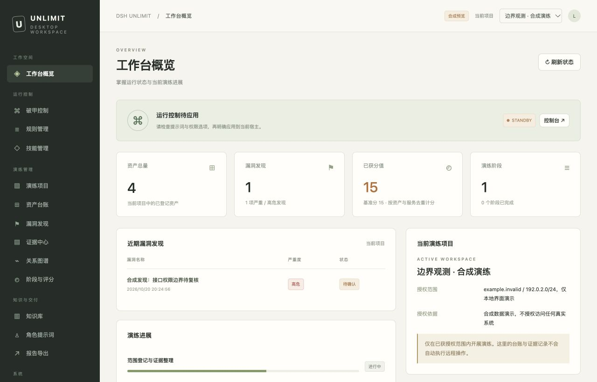

# dsh-unlimit

面向 **DeepSeek Harness 桌面端 0.2.1-rc.2** 的独立运行控制与演练工作台。自写系统提示词、规则与技能管理、会话回退、本地资产和证据管理使用同一套本地服务，页面重新设计。

**当前为 0.1.0 适配基线，尚未完成全部桌面能力的 1:1 验收。** macOS arm64 是当前目标；官方模块隔离测试与真实桌面安装是两种证据。具体已验证行为和缺口见 [验证记录](docs/verification.md) 与 [功能对照](docs/parity.md)。

## 现在可以做什么

- 替换或追加系统正文，保留模式、PTC SDK、MCP 等功能说明；保存多套规则、按模型选择规则、选择本地工作区规则，每轮与重试读取当前正文。
- 通过已核验的原生接口，按 strict / fallback / always 处理工作区基线及刷新消息；历史保留原日志，切回保留或还原时恢复仍由本插件持有的节点。原生入口摘要不符时明确不支持，当前只完成官方隔离验收。
- 从宿主目录选择未来新会话的默认权限预设，配置未明确选定策略时的审批和访问行为、子代理数量与深度。已有会话和显式选择保持有效；撤销恢复未来默认，不回滚已创建会话。
- 按需关闭官方重复调用建议提醒，恢复时沿用原配置。工具拒绝与取消仍有效；配置不写入宿主 profile，外部修改发生冲突时保留。
- 按需接管模型请求的重试次数（0–20），沿用官方退避、Retry-After、取消和日志；默认沿用提供方策略。
- 对根会话明确的输出长度截断手动继续，或启用有次数上限的自动继续。保留插件消息来源，用户停止、传输错误和限流不会触发新轮次；自动继续默认关闭。
- 创建、编辑、导入、覆盖、删除技能，通过宿主技能目录发现它们。支持 ZIP、SKILL.md 和文件夹，单次新导入最多200个普通文件；覆盖与删除保留本地备份。
- 按会话读取宿主技能、工具和本项目技能的来源与正文，预检明确声明的工具、目录、变量、主机登记和私钥元信息；未声明或来源不可用时显示未知。
- 用新界面管理演练项目、资产与服务、发现、证据、关系图、阶段评分、共享知识、原创角色稿和 Markdown 报告。
- 在 WebShell/隧道台账中预览并确认一次连接检查：HTTP HEAD 或明确监听端的 TCP 连接，分别保存实际结果、时间和延迟，支持取消与过期标记。当前限精确登记的自有服务器，地区判定和宿主通用网络出口仍未适配；[连接检查合同](docs/connection-checks-contract.md) 说明边界。
- 凭据登记可关联资产与服务、记录角色和来源；API 与模型只读回元数据和保存状态。编辑时留空保留秘密，填新值替换，明确勾选才清空；密码不进入页面草稿。
- 保存工作区文本、文件和图片证据，核对摘要、预览图片；覆盖或删除保留可恢复备份。按已登记的资产关系查询最短路径。
- 将会话明确绑定到项目；模型工具与页面使用同一数据服务，子会话继承项目绑定。
- 从已绑定的父会话分派明确任务，先领取本地槽位再创建官方执行者；查看收据、停止并确认释放。可注册和撤销本项目的原创运行时预设。
- 提交带明确依赖的多任务计划，按槽位排队，把前序原始结果传给直接依赖任务；缺依赖、失败或清理未确认均可读回。计划只保留于本次运行，不内置自动任务拆解。
- 演练入口有当前安装的阅读、倒计时与逐项确认，支持撤销并重试清理所属执行者；该确认不授予任何目标访问权限，普通设置独立可用。
- 管理本地普通/秘密变量、连接主机和私钥路径元信息；秘密不读回正文，不进入页面草稿。配置使用文件权限保护，未加密，也不自动注入进程或提示词。
- 通过官方会话接口准备回退、创建分支并归档旧会话；文字、图片与文件草稿分别报告恢复状态，文件通过官方上传生成新收据。原生待办列表沿用分支事件投影；附件的真实桌面操作、外部任务恢复及子代理映射仍未验收。
- 配置逐工具路径、工具根、额外目录和模板目录，运行固定版本/帮助检查，区分两个同名的 `httpx` 产品。登记资产、凭据或会话不会执行远程操作。
- 按路径或正文检索本地模板、读取全文与摘要，再整理为带来源的未验证知识条目。页面未保存编辑按对象保留在内存中，刷新前会提示。

没有自动更新、激活服务、分析埋点或其他插件作者的服务依赖。模型请求仍通过使用者配置的宿主模型服务发送；“本地维护”不表示在线模型变成离线模型。



## 本地开发与预览

需要 Node.js **24.13 或更高版本**。没有 npm 运行时依赖；Prettier 仅用于开发期格式化。

```sh
npm ci
npm run check
npm test
npm run build
npm run preview
```

统一源码格式使用 `npm run format`，只检查格式使用 `npm run format:check`。

打开终端打印的 `http://127.0.0.1:4177/dsh-unlimit/ui/`。预览使用临时 SQLite、原创合成记录和独立技能目录，只监听回环地址；退出后清理这些临时数据。预览不能启用真实宿主控制，也不读取真实 profile。

```sh
npm run doctor -- --app "/Applications/DeepSeek Harness.app"
npm run pack:local
```

`doctor` 只读检查安装版本与必要模块。安装包位于 `artifacts/dsh-unlimit-0.1.0.tgz`，打包命令同时输出 SHA-256。不要将预览数据库或用户资料复制进源码目录。

## 桌面安装与回退

先关闭其他执行同类运行时修改的插件，备份桌面 profile。若应用本体已有其他工具的修改，先按其恢复流程恢复；本项目不负责覆盖其他工具的修改。

0.2.1-rc.2 的官方插件管理器支持绝对本地目录和 tarball 路径。将构建后的 `.tgz` **绝对路径**作为安装来源，核对名称 `dsh-unlimit` 后使用官方安装流程。此仓库未在真实用户 profile 上执行该流程；若你的桌面界面没有本地来源入口，应先核对宿主能力，不手工改写应用文件。

加载后通过 **U · 工作台** 打开页面。先填写自写正文、检查诊断状态，再主动点击应用。聊天入口为 `/unlimit status`、`/unlimit apply`、`/unlimit revert`。默认安装状态不启用运行控制。演练区需完成本安装的入口确认；工具与环境可明确选择暂不配置，均不修改宿主的普通聊天权限。

还原只撤销本插件的运行时修改，保留规则、技能及台账。诊断页的“卸载本插件（保留资料）”在确认后先持久禁用、撤销演练确认、停止所属任务并恢复运行控制，再调用官方插件管理器并读回结果。清理失败不移除，未知结果不自动重试，不自动重启；仅匹配当前实例的profile安装包才开放入口。直接从官方插件管理器卸载不经过这条准备链，入场确认清理尚未覆盖；真实桌面卸载也尚未验收，见 [卸载合同](docs/maintenance-contract.md)。持久数据位于当前桌面 profile 的 `data/dsh-unlimit/`；备份时应退出插件后复制该目录。不要直接删除其中的数据库或技能备份。

## 适配验证

```sh
export DSH_UNLIMIT_RUNTIME="/Applications/DeepSeek Harness.app/Contents/Resources/app/dsh"
export DSH_UNLIMIT_OFFICIAL_PACKAGES="/path/to/ignored/official-packages"
node --expose-internals --test tests/*.test.mjs
node scripts/verify-host.mjs --runtime "$DSH_UNLIMIT_RUNTIME"
node scripts/verify-protocols.mjs --runtime "$DSH_UNLIMIT_RUNTIME"
```

这些检查只在新建上下文中使用官方模块、合成会话和临时数据。原生规则测试经过官方 producer、AgentLoop 与真实 JSONL，逐次核对请求和磁盘重建；文件权限测试实际调用官方读取、创建、编辑及预览接口。协议测试经过官方适配器及 SDK，最终由假传输端接收；回退、继续、请求重试、工作流与会话目录另有官方隔离测试。不调用真实模型，不读取真实会话，不修改宿主。

读取窗口、文件权限与原生规则测试另需公开的 `dsh-tool-fs`、`dsh-agent-instructions` 确切版本归档，来源与完整性见 [复验说明](docs/verification.md#本地复验命令)。测试不自动下载；环境门缺失时明确跳过，显式配置后归档缺失或摘要不符则失败。`--expose-internals` 仅供隔离测试的模块解析钩子使用。

校验脚本检查直接导入入口，部分专项还核对所有执行的官方文件；这些都不构成宿主全量审计。当前已安装程序中有若干入口摘要不符，测试使用校验过的临时副本，不会修复实际安装。Hook 与第三方记忆策略、真实终端执行和桌面安装等剩余项仍见功能对照。

## 维护结构

| 目录          | 职责                                       |
| ------------- | ------------------------------------------ |
| `src/core/`   | 本地数据、规则、技能、角色槽位、工具目录   |
| `src/host/`   | 版本门、官方服务适配、运行时恢复与会话操作 |
| `src/server/` | 宿主认证后的同源 API 与页面资源            |
| `web/`        | 原生 JavaScript 桌面工作台                 |
| `scripts/`    | 检查、构建、打包与隔离验收                 |
| `tests/`      | 合成数据与官方模块集成测试                 |

后续版本先运行只读检查、更新行为对照，再增加适配与对应测试。新版本不会因版本号相似而自动获准应用。具体步骤见 [版本维护流程](docs/maintenance.md)，接口与数据约定见 [开发合同](docs/contract.md)。

本项目按用户行为独立编写。来源、宿主许可证边界与当前仓库许可状态见 [NOTICE.md](NOTICE.md)。
